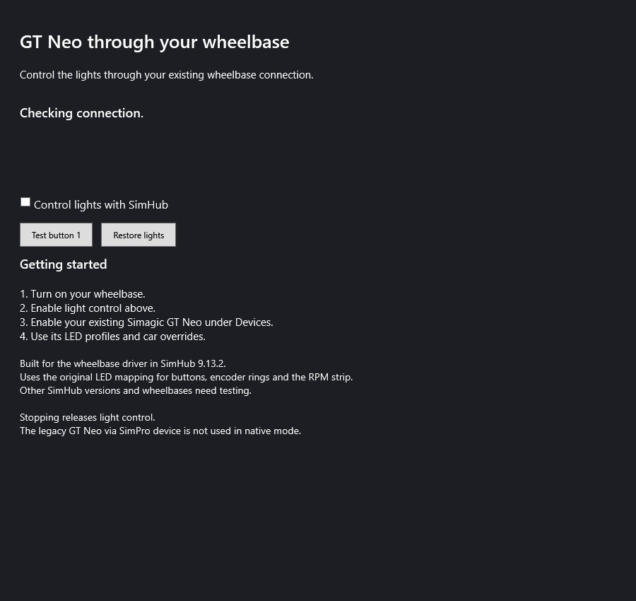

# Simagic Bridge for SimHub

Control a **Simagic GT Neo** through its existing wheelbase connection, without a separate USB cable to the wheel. The bridge attaches to SimHub's existing **Simagic GT Neo** device so you can keep its LED profiles, brightness settings and car overrides.

**Version 0.2.2 — experimental.** This release adds an English interface and documentation to the 0.2.1 transport. It is an independent community plugin, not an official Simagic or SimHub product.



## Compatibility

| Component | Tested locally |
| --- | --- |
| SimHub | 9.13.2 on Windows |
| Steering wheel | GT Neo, firmware 1.4.4 |
| Wheelbase reported by the device API | Alpha EVO Ultra, firmware 2.3.6 |
| Wheel/base identifiers observed | Wheel PID `0x0805`, base PID `0x0502` |

The owner described the base as an Alpha U/Ultimate, but the device API reported Alpha EVO Ultra. **Alpha U/Ultimate compatibility is therefore not independently confirmed.** Other wheelbases, wheels, firmware and SimHub versions need testing.

Visible LED output through the base has been confirmed locally. Intermittent LED connection losses were reported with 0.2.0. The 0.2.1 transport extends the heartbeat timeout and shortens reconnection intervals; long-session reliability remains to be verified.

## Install

1. Close SimHub normally.
2. Copy `User.SimagicBridge.dll` from the release package into your SimHub installation folder, usually `C:\Program Files (x86)\SimHub`. Keep a backup if replacing an earlier version.
3. Start SimHub. Enable **Simagic Bridge** in **Add/remove features** and enable its main-menu entry.
4. Open **Simagic Bridge** and enable **Control lights with SimHub**.
5. Under **Devices**, enable your existing **Simagic GT Neo**. Configure your usual LED profiles and car overrides there.

If Windows blocks the downloaded DLL, open its file Properties and select **Unblock**, if that option is present, before starting SimHub.

Use **Test button 1** while the vehicle is stationary. It requests cyan on the first button channel for 3 seconds. Raw effects and other overrides can affect the visible result. Native mode is enabled by default; the separate **GT Neo via SimPro** device is only for the legacy API prototype.

Existing installations use the same DLL name, plugin identity and settings keys. Replace the older DLL rather than loading both versions. Installing this English release does not require importing new LED profiles.

## Profiles and car overrides

The bridge provides the transport. SimHub still renders your profiles, evaluates telemetry, selects car overrides and applies effect priorities. Configure those in the existing GT Neo device tabs. The bridge does not supply a car-specific profile or add telemetry that the game does not expose.

The native mapping follows SimHub 9.13.2: 10 button lights, 4 encoder rings with 12 LEDs each, 15 RPM LEDs and 4 auxiliary lights. The rings are included in the native button-group mapping. Existing logical channel counts are retained.

## Build and test

Requirements: Windows, .NET Framework 4.8, Windows PowerShell and an installed SimHub 9.13.2. The scripts use the Windows .NET Framework compiler and reference DLLs from your own SimHub installation. Vendor DLLs are not included.

Run from the repository root:

```powershell
.\tools\Build.ps1
.\tools\Test.ps1
# Close SimHub first. Installation may require an elevated PowerShell.
.\tools\Install.ps1
```

For a custom installation folder, pass `-SimHubPath 'D:\SimHub'` to any of these scripts. Build output is `artifacts\User.SimagicBridge.dll`. The installer backs up an existing plugin DLL under `diagnostics\private\installed-plugin-backups` and checks the copied file's SHA-256 hash.

The default tests use a fixture and simulated API responses; they do not send commands to your wheel. They check LED mapping, preservation of device profiles, driver ownership, legacy write sequencing and recovery. SimHub's SDK may update its own plugin cache during testing, requiring write access to the installation folder.

`Test.ps1 -Preview` renders the English settings screen. `Test.ps1 -Live` is a separate **legacy API test that temporarily changes real wheel lights**, then restores them; it does not validate the native transport. Run it only deliberately while stationary with SimPro running.

## Troubleshooting

- **No lights:** enable both the bridge's light-control checkbox and the existing GT Neo device. Check that your LED profile has active effects and nonzero brightness.
- **No wheelbase driver:** the bridge depends on internal signatures in SimHub 9.13.2. A SimHub update can require a plugin update.
- **Brief LED dropouts:** collect the relevant `[SimagicBridge]` messages from SimHub's log and record your hardware, firmware and SimHub version. Heartbeat tolerance is 5 seconds; reconnection and refresh intervals are 1 second. These values do not guarantee uninterrupted output.
- **SimPro error with native LEDs working:** SimPro is queried separately for device information and legacy recovery. Its API status is separate from native LED output.
- **Restore pending:** see [the recovery notes](docs/TECHNICAL.md#legacy-api-recovery). Do not delete a pending recovery file before restoring the saved values.

Logs can contain local paths and device identifiers. Review and redact them before posting a public issue.

## Uninstall

Stop light control, close SimHub normally and remove only `User.SimagicBridge.dll` from the installation folder. Your existing GT Neo profiles remain in SimHub. If you used the legacy API mode, complete any pending light restore before removing the plugin.

## Development and releases

See [technical notes](docs/TECHNICAL.md), [release notes](CHANGELOG.md) and [publishing instructions](docs/PUBLISHING.md). This repository contains bridge source, scripts and a test fixture only. It does not redistribute SimHub or Simagic SDK binaries.

Bridge source is licensed under [MIT](LICENSE). Third-party software remains subject to its own terms.
